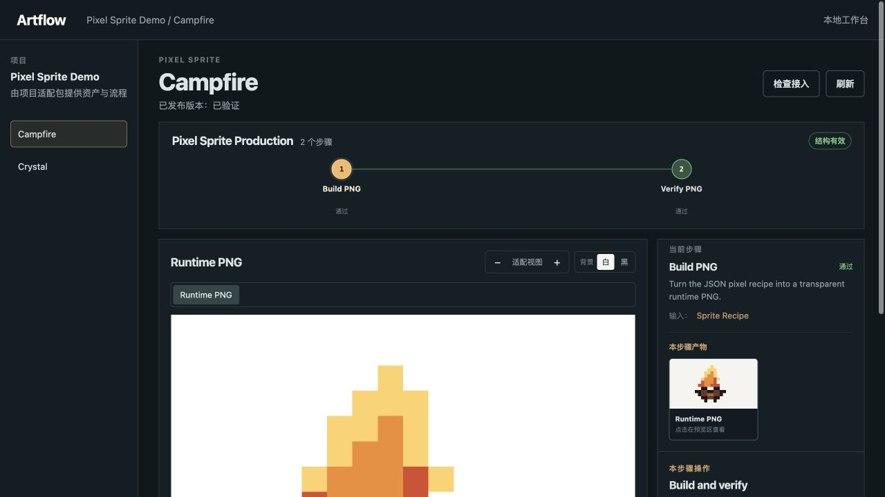

# Artflow

Artflow is a local workbench for repeatable, reviewable art production. A small
JSON adapter connects your existing tools and files; Artflow shows each step,
previews artifacts, asks for approval before writes, and records what ran.



## Try it in 60 seconds

From this repository:

```sh
python3 -S examples/run_demo.py
```

Open <http://127.0.0.1:4179>, choose **Campfire**, click **Build PNG**, review
**Build and verify**, and enter `campfire` to run it.

If port 4179 is already in use, choose another one:

```sh
python3 -S examples/run_demo.py --port 4180
```

The demo needs only:

- Python 3.11+
- macOS or Linux
- a web browser

It does **not** need Godot, Unity, Aseprite, Node.js, Pillow, PyYAML, or any
third-party Python package. `-S` disables `site-packages`, so the command also
works offline. The example creates a transparent 64×64 PNG with the standard
library and validates it before Artflow marks the run as verified.

- [Step-by-step quick start](docs/getting-started.md)
- [Connect your own project](docs/integration-guide.md)
- [中文快速上手与接入指南](docs/guide.zh-CN.md)
- [Browse the embedded example](src/artflow/examples/starter)

## How it fits your project

```text
project.json      tells Artflow which assets, files, and tools exist
pipelines.json    defines ordered steps and user-facing actions
your tool/CLI     creates or validates the actual art files
Artflow           plans, runs, previews, locks, and records the work
```

Your tools do not import Artflow. They remain normal command-line programs and
report success with an exit code or a JSON result. The core does not know about
your engine, asset types, naming rules, or folder layout.

## Install it for regular use

The zero-install demo above is the fastest way to evaluate Artflow. To use the
`artflow` command from any directory, install this checkout into an environment:

> Artflow has not published an official PyPI distribution yet. The `artflow`
> name on PyPI belongs to another project, so do not use `pip install artflow`
> for this workbench. Install this checkout until a distribution name is chosen.

```sh
python3 -m venv .venv
.venv/bin/python -m pip install .
.venv/bin/artflow init ./my-art-studio
.venv/bin/artflow check --project ./my-art-studio/project.json
.venv/bin/artflow serve --project ./my-art-studio/project.json
```

`artflow init` copies the same pixel-sprite example used by the repository demo.
For source development, prefix commands with `PYTHONPATH=src python3 -m artflow`.

## Core commands

```sh
artflow --version
artflow doctor --project project.json
artflow check --project project.json
artflow plan --project project.json --asset campfire --action build
artflow run --project project.json --asset campfire --action build --confirm campfire
artflow serve --project project.json
```

- `doctor` gives a short, human-readable runtime and project diagnosis.
- `check` validates paths, pipeline structure, executors, command allowlists,
  required inputs, tool version files, preview references, and review boundaries
  without running production tools.
- `plan` resolves the exact command, inputs, outputs, hashes, and locks.
- `run` executes the reviewed plan and records results.
- `serve` opens the local workbench at <http://127.0.0.1:4179>.

## Included capabilities

- Configuration-driven assets, pipelines, actions, and previews.
- One immutable execution plan shared by review and execution.
- Explicit approval before write steps.
- Background jobs, live logs, cancellation, timeouts, and failure handling.
- Bounded log capture, so a noisy production tool cannot fill temporary storage.
- SQLite history with input, output, configuration, and tool fingerprints.
- Automatic stale-state propagation when tracked files change.
- Cross-project resource and file locks.
- Image, audio, and video previews; other artifacts remain downloadable.
- Localhost-only HTTP with per-session write tokens.

Adapters are trusted local configuration. Commands run with the user's
permissions; output declarations coordinate and audit writes but are not an OS
sandbox. Only connect tools and adapters you trust.

## Reference and development

- [Adapter reference](docs/adapter.md)
- [Architecture](docs/architecture.md)
- [Release checklist](docs/releasing.md)
- [Contributing](CONTRIBUTING.md)
- [Security policy](SECURITY.md)

```sh
PYTHONDONTWRITEBYTECODE=1 PYTHONPATH=src python3 -m unittest discover -s tests -v
node --check src/artflow/web/app.js
python3 -m pip wheel --no-deps . --wheel-dir dist
```

Artflow 0.2 supports adapter schema 2. Older schema 1 adapters must be migrated
explicitly; existing legacy run records are retained but are not relabeled as
current verified runs. Windows support is not implemented yet because process
groups and file locks currently use POSIX behavior.
