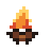
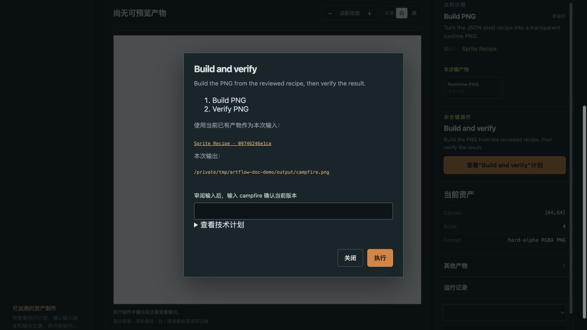
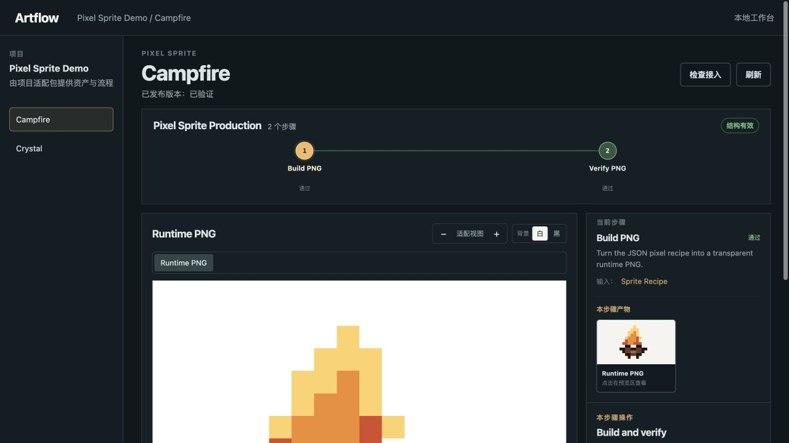

# Quick start: build a pixel sprite

This walkthrough uses the example included in the repository. It creates a
transparent game-ready PNG, verifies it, previews it, and records the run. No
creative application or third-party Python package is involved.

| Campfire | Crystal |
| --- | --- |
|  |  |

## 1. Start the demo

You need Python 3.11+ on macOS or Linux. From the repository root:

```sh
python3 -S examples/run_demo.py
```

`-S` disables third-party `site-packages`. On the first run, the launcher copies
the canonical example into `.artflow-demo/`, an ignored working directory. Open
<http://127.0.0.1:4179> in a browser.

If port 4179 is already in use, add `--port 4180` and open the address printed
in the terminal.

## 2. Review the plan

Select **Campfire**, select **Build PNG**, then click **Build and verify**.
Artflow shows the exact input, output, and two commands it will run.



Enter `campfire` in the confirmation field and click the orange confirmation
button. The asset ID is required because this action writes a file.

## 3. Inspect the result

The pipeline should show two passed steps:

1. **Build PNG** turns `inputs/campfire.json` into `output/campfire.png`.
2. **Verify PNG** checks PNG chunks, CRC values, RGBA format, and transparency.

The generated image appears in the main preview and as a step output. The run
record keeps the command, logs, input hash, output hash, and approval.



## 4. See stale-state tracking

Open `.artflow-demo/inputs/campfire.json` and change one palette color, for
example `"Y": "#FFF2A8"`. Save the file and click **Refresh** in Artflow.

The previous build becomes **stale** because its reviewed input changed. Run
**Build and verify** again to create a result tied to the new recipe.

## What each file does

| File | Responsibility |
| --- | --- |
| `project.json` | Declares assets, file paths, the tool entry point, and allowed commands. |
| `pipelines.json` | Defines the production steps and buttons shown to the user. |
| `make_asset.py` | Builds and verifies the PNG; it does not import Artflow. |
| `inputs/*.json` | Editable pixel recipes used as reviewed inputs. |
| `output/*.png` | Generated artifacts shown in the workbench. |
| `.artflow-state/` | Local SQLite run history; ignored by Git. |

The packaged source is under
[`src/artflow/examples/starter`](../src/artflow/examples/starter). The launcher
copies it so experimentation never edits the canonical example.

Next, follow [Connect your project](integration-guide.md) and replace the demo
tool and paths with your own.
