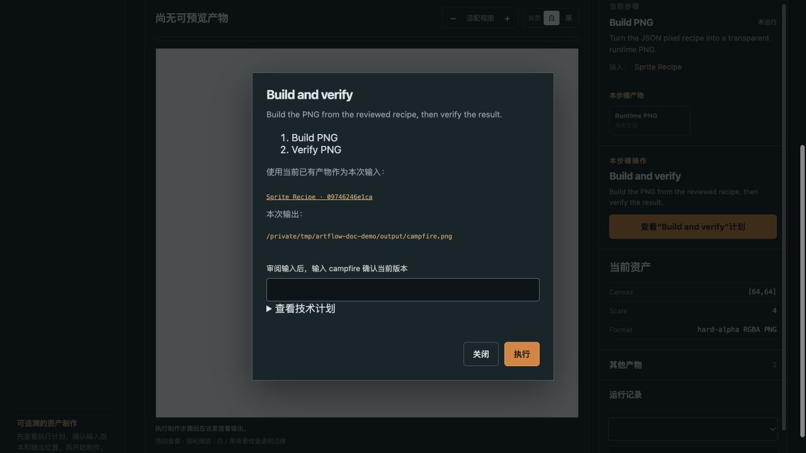
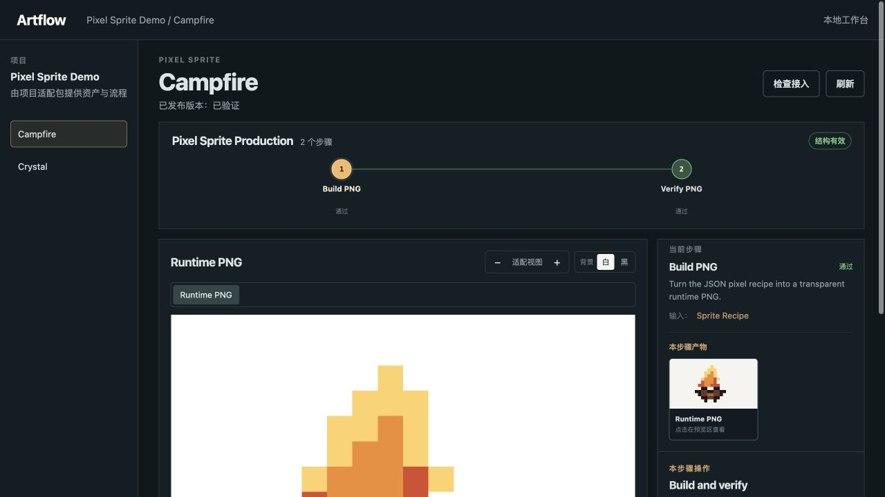

# 快速上手与项目接入

这个仓库内置了一个像素精灵案例，只需 Python 3.11+ 和浏览器。它不依赖
Godot、Unity、Aseprite、Node.js、Pillow、PyYAML 或其他 Python 包。

| 篝火 | 晶体 |
| --- | --- |
|  |  |

## 运行案例

在 Artflow 仓库根目录执行：

```sh
python3 -S examples/run_demo.py
```

打开 <http://127.0.0.1:4179>，选择 **Campfire**，再选择 **Build PNG** 并
打开 **Build and verify** 计划。

如果 4179 端口被占用，可在命令末尾加 `--port 4180`，再打开终端显示的地址。



输入 `campfire` 后点击 **执行**。Artflow 会：

1. 读取 `.artflow-demo/inputs/campfire.json`。
2. 用 Python 标准库生成透明的 64×64 PNG。
3. 检查 PNG 结构、CRC、RGBA 格式和透明通道。
4. 展示图片，并保存命令、日志、文件哈希与审批记录。



把 `.artflow-demo/inputs/campfire.json` 中的 `"Y": "#FFD166"` 改成
`"Y": "#FFF2A8"`，保存并刷新页面，旧结果会变成“已过期”。
这表示当前图片不再对应已审阅的输入，需要重新执行。

## 案例的五个文件

| 文件 | 用途 |
| --- | --- |
| `project.json` | 声明资产、路径、工具入口和允许执行的命令。 |
| `pipelines.json` | 声明页面显示的步骤和操作。 |
| `make_asset.py` | 项目自己的制作工具，不需要导入 Artflow。 |
| `inputs/*.json` | 被审阅的输入配方。 |
| `output/*.png` | 制作结果，由页面直接预览。 |

## 接入自己的项目

推荐把项目配置放进游戏仓库：

```text
my-game/
├── .artflow/project.json
├── .artflow/pipelines.json
├── art/source/
├── game/assets/
└── tools/export_asset.py
```

接入只需五步：

1. 执行 `artflow init ./my-game/.artflow` 复制案例配置。
2. 在 `project.json` 的 `roots` 和 `artifacts` 中换成真实路径。
3. 把 `executors.argv` 换成已有制作脚本，并在 `allowed_commands` 中登记命令。
4. 在 `pipelines.json` 中声明输入、输出、步骤和页面按钮。
5. 依次运行 `check`、`plan`、`serve`。

如果还没有安装 Artflow，可直接从源码仓库执行第一步：

```sh
PYTHONPATH=/path/to/artflow/src python3 -S -m artflow init ./my-game/.artflow
```

后续命令也可用同样的 `PYTHONPATH=/path/to/artflow/src python3 -S -m artflow`
前缀替代 `artflow`。正式安装后则直接使用下面的短命令。

```sh
artflow doctor --project ./my-game/.artflow/project.json
artflow check --project ./my-game/.artflow/project.json
artflow plan --project ./my-game/.artflow/project.json --asset hero --action build
artflow serve --project ./my-game/.artflow/project.json
```

项目工具仍是普通命令行程序：成功时退出码为 `0`，并生成声明的输出文件即可；
它不需要依赖 Artflow。写入步骤必须声明 `outputs`、`requires_approval`、
`approval_artifacts` 和 `locks`，页面才能在执行前展示准确的影响范围。

完整配置示例见 [英文接入指南](integration-guide.md)，字段解释见
[适配器参考](adapter.md)。
